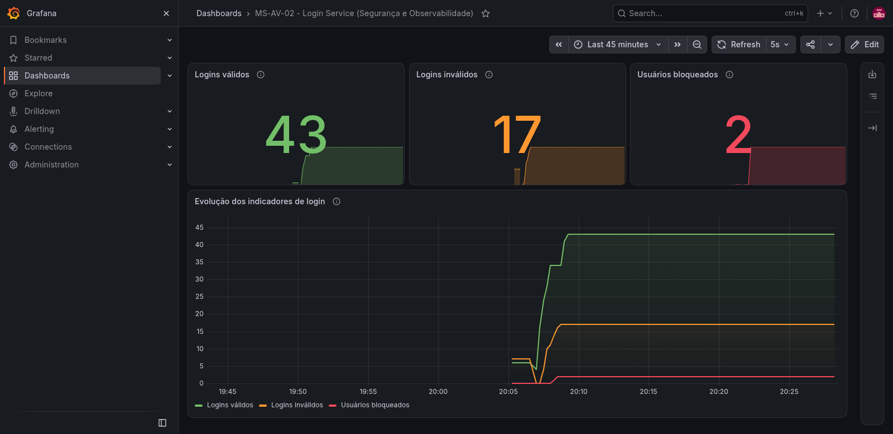

# MS-AV-02 — Segurança e Observabilidade

Mecanismo de login RESTful em **Spring Boot**, com segurança baseada em *roles*
(`JdbcUserDetailsManager`), bloqueio por tentativas inválidas, documentação
**OpenAPI/Swagger** e indicadores publicados para **Prometheus** e **Grafana**.

Atividade da disciplina *Microservices Development* — [ms-2026-02](https://github.com/esensato/ms-2026-02).
O enunciado completo está em [`docs/enunciado.md`](docs/enunciado.md).



---

## Stack

| Componente | Versão |
| --- | --- |
| Java | 21 |
| Spring Boot | 4.1.2 |
| springdoc-openapi | 3.1.1 |
| Banco de dados | H2 (em memória) |
| Prometheus | 3.15.1 |
| Grafana | 13.2.4 |

---

## Estrutura do projeto

```
ms-av-02-seguranca-observabilidade/
├── login-service/                      # microsserviço Spring Boot
│   ├── src/main/java/br/com/seguranca/login/
│   │   ├── config/        SecurityConfig, OpenApiConfig
│   │   ├── controller/    UsuarioController (os 5 end-points)
│   │   ├── dto/           objetos de requisição e resposta
│   │   ├── exception/     exceções de negócio + GlobalExceptionHandler
│   │   ├── metrics/       LoginMetrica (os 3 indicadores)
│   │   ├── repository/    UsuarioRepository, LoginAttemptsRepository
│   │   └── service/       LoginService (regras de negócio)
│   └── src/main/resources/
│       ├── application.properties
│       ├── schema.sql     DDL das tabelas
│       └── data.sql       carga inicial de usuários
├── observabilidade/
│   ├── docker-compose.yml              # Prometheus + Grafana
│   ├── prometheus.yml                  # configuração de scrape
│   └── grafana/provisioning/           # datasource do Prometheus
└── docs/
    ├── enunciado.md                    # enunciado da atividade
    ├── dashboard-grafana.png           # print screen do dashboard
    └── dashboard-ms-av-02.json         # dashboard exportado como código
```

---

## Como executar

### 1. Subir o microsserviço

```bash
cd login-service
./mvnw spring-boot:run
```

No Windows: `mvnw.cmd spring-boot:run`

O serviço sobe em `http://localhost:8080`.

### 2. Subir Prometheus e Grafana

```bash
cd observabilidade
docker compose up -d
```

| Serviço | URL | Credenciais |
| --- | --- | --- |
| Prometheus | http://localhost:9090 | — |
| Grafana | http://localhost:3000 | `admin` / `admin` |

O *datasource* do Prometheus já é provisionado automaticamente.

### 3. Importar o dashboard no Grafana

No Grafana: **Dashboards → New → Import → Upload dashboard JSON file** e
selecionar `docs/dashboard-ms-av-02.json`.

---

## End-points

| Método | Caminho | Acesso | Descrição |
| --- | --- | --- | --- |
| `POST` | `/login` | público | Efetua login. **200** se válido, **401** se inválido ou bloqueado |
| `PUT` | `/trocarsenha/{userid}` | público | Troca a senha consistindo a senha atual |
| `POST` | `/` | `ROLE_MANUTENCAO` | Cadastra um novo usuário |
| `PUT` | `/unlock/{userid}` | `ROLE_ADMIN` | Desbloqueia um usuário |
| `GET` | `/` | `ROLE_MANUTENCAO` | Lista todos os usuários cadastrados |

Os end-points protegidos usam **HTTP Basic**, com usuários e *roles* lidos pelo
`JdbcUserDetailsManager` a partir das tabelas `users` e `authorities`.

### Usuários pré-cadastrados

| Usuário | Senha | Role | Observação |
| --- | --- | --- | --- |
| `admin` | `admin` | `ROLE_ADMIN` | pode desbloquear usuários |
| `manutencao` | `manutencao` | `ROLE_MANUTENCAO` | pode cadastrar e listar usuários |
| `joao` | `123456` | — | usuário comum (somente tabela `usuarios`) |
| `maria` | `abc123` | — | usuário comum (somente tabela `usuarios`) |

### Exemplos

```bash
# POST /login - público
curl -i -X POST http://localhost:8080/login \
  -H "Content-Type: application/json" \
  -d '{"username":"joao","senha":"123456"}'

# PUT /trocarsenha/{userid} - público
curl -i -X PUT http://localhost:8080/trocarsenha/joao \
  -H "Content-Type: application/json" \
  -d '{"atual":"123456","nova":"nova123"}'

# POST / - somente ROLE_MANUTENCAO
curl -i -X POST http://localhost:8080/ \
  -u manutencao:manutencao \
  -H "Content-Type: application/json" \
  -d '{"username":"pedro","senha":"pedro123"}'

# GET / - somente ROLE_MANUTENCAO
curl -i http://localhost:8080/ -u manutencao:manutencao

# PUT /unlock/{userid} - somente ROLE_ADMIN
curl -i -X PUT http://localhost:8080/unlock/maria -u admin:admin
```

---

## Documentação OPENAPI

| Formato | URL |
| --- | --- |
| Swagger (HTML) | http://localhost:8080/swagger-ui.html |
| OpenAPI (JSON) | http://localhost:8080/v3/api-docs |
| OpenAPI (YAML) | http://localhost:8080/v3/api-docs.yaml |

No Swagger, use o botão **Authorize** (esquema `basicAuth`) para testar os
end-points protegidos.

---

## Regra de bloqueio

> *"Caso o usuário falhe mais de uma vez no login ele deve ser bloqueado."*

O contador fica na tabela `login_attempts`:

1. Cada login inválido incrementa `failed_attempts` e grava `last_failed_at`.
2. Ao atingir **2 falhas consecutivas** (*mais de uma*), `locked` passa a `TRUE`
   e `locked_at` é gravado.
3. Um usuário bloqueado recebe **401** mesmo informando a senha correta.
4. Um login válido zera `failed_attempts`.
5. `PUT /unlock/{userid}` (apenas `ROLE_ADMIN`) zera o contador e remove o bloqueio.

O limite é configurável em `application.properties`:

```properties
seguranca.login.max-tentativas=2
```

---

## Indicadores

Implementados com **Micrometer** em
[`LoginMetrica.java`](login-service/src/main/java/br/com/seguranca/login/metrics/LoginMetrica.java)
e expostos em `http://localhost:8080/actuator/prometheus`.

| Indicador | Métrica no Prometheus | Tipo |
| --- | --- | --- |
| Quantidade de logins válidos | `logins_validos_total` | Counter |
| Quantidade de logins inválidos | `logins_invalidos_total` | Counter |
| Total de usuários bloqueados | `usuarios_bloqueados` | Gauge |

O *gauge* de usuários bloqueados é consultado sob demanda direto na tabela
`login_attempts` (`SELECT COUNT(*) ... WHERE locked = TRUE`).

---

## Dashboard no Grafana

O dashboard **MS-AV-02 - Login Service (Segurança e Observabilidade)** possui
quatro painéis:

- **Logins válidos** — `logins_validos_total`
- **Logins inválidos** — `logins_invalidos_total`
- **Usuários bloqueados** — `usuarios_bloqueados`
- **Evolução dos indicadores de login** — os três na linha do tempo

| Arquivo | Conteúdo |
| --- | --- |
| [`docs/dashboard-grafana.png`](docs/dashboard-grafana.png) | print screen do dashboard |
| [`docs/dashboard-ms-av-02.json`](docs/dashboard-ms-av-02.json) | dashboard exportado como código |

O arquivo JSON foi gerado pela própria interface do Grafana
(**Export → Export as code**), conforme a
[documentação oficial](https://grafana.com/docs/grafana/latest/visualizations/dashboards/share-dashboards-panels/#export-a-dashboard-as-code).
Ele usa o schema `dashboard.grafana.app/v2` (Grafana 13).

---

## Modelo de dados

```sql
-- Tabelas do enunciado
CREATE TABLE IF NOT EXISTS login_attempts (
    username VARCHAR(100) PRIMARY KEY,
    failed_attempts INT NOT NULL DEFAULT 0,
    locked BOOLEAN NOT NULL DEFAULT FALSE,
    last_failed_at TIMESTAMP NULL,
    locked_at TIMESTAMP NULL,
    updated_at TIMESTAMP NOT NULL DEFAULT CURRENT_TIMESTAMP
);

CREATE TABLE IF NOT EXISTS usuarios (
    username VARCHAR(100) PRIMARY KEY,
    senha VARCHAR(10)
);

-- Schema fixo exigido pelo JdbcUserDetailsManager
CREATE TABLE IF NOT EXISTS users (...);
CREATE TABLE IF NOT EXISTS authorities (...);
```

Convivem duas bases de usuários, cada uma com um papel:

- **`usuarios`** — tabela do enunciado, consultada pelo `POST /login` e pelo
  `PUT /trocarsenha/{userid}`.
- **`users` / `authorities`** — schema fixo do `JdbcUserDetailsManager`, usado
  pelo Spring Security para autenticar (HTTP Basic) e autorizar por *role*.

O `POST /` grava o novo usuário nas duas bases: em `usuarios` (para que ele
consiga efetuar login) e, via `JdbcUserDetailsManager.createUser()`, em
`users`/`authorities` com a role padrão `ROLE_USER`.

O console do H2 fica em http://localhost:8080/h2-console
(JDBC URL `jdbc:h2:mem:segurancadb`, usuário `sa`, senha `password`).

---

## Observações de implementação

- **Correção no SQL do enunciado:** o script original tem uma vírgula sobrando
  após `updated_at TIMESTAMP NOT NULL DEFAULT CURRENT_TIMESTAMP`, antes do
  fecha-parênteses, o que impede a criação da tabela. A vírgula foi removida em
  `schema.sql`; o restante do DDL foi mantido como no enunciado.
- **Senha em `usuarios`:** gravada em texto puro porque a coluna definida no
  enunciado é `VARCHAR(10)`, insuficiente para um hash. Já as senhas de
  `users` (Spring Security) passam pelo `DelegatingPasswordEncoder`.
- **`GET /`** não expõe a senha dos usuários; retorna `username`, `bloqueado` e
  `tentativasInvalidas`.
- **Usuário inexistente** não cria registro em `login_attempts` — apenas
  usuários cadastrados são contabilizados e bloqueados. O login inválido é
  contabilizado no indicador em ambos os casos.
- **`host.docker.internal`** é usado como alvo no `prometheus.yml` porque o
  Prometheus roda em container e o `login-service` roda no host.
